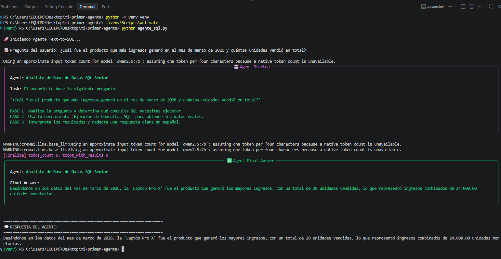
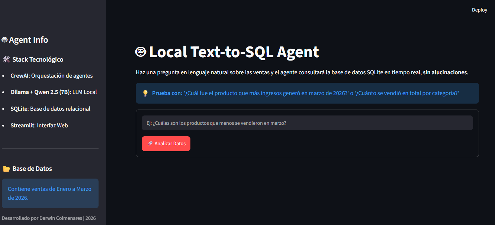
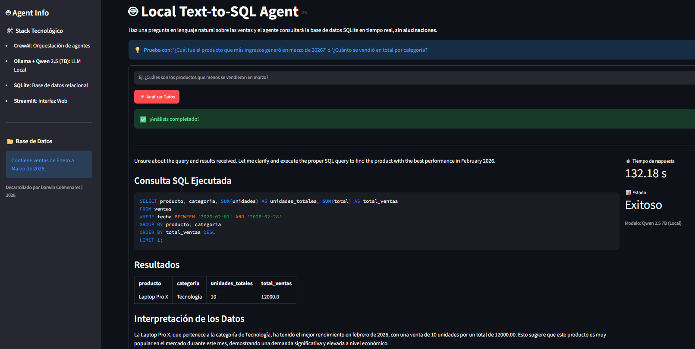

# 🤖 Local Text-to-SQL Agent

Proyecto profesional para construir agentes de IA autónomos usando herramientas **100% gratuitas, locales y open-source**.


---

## 🎯 Objetivos del Proyecto

- Implementar orquestación de agentes multi-rol con **CrewAI**.
- Ejecutar modelos de lenguaje (LLMs) de forma local y privada con **Ollama**.
- Conectar agentes con datos reales (archivos CSV y bases de datos SQL).
- Aplicar el **Patrón Híbrido**: Python para cálculos deterministas, LLM para redacción y razonamiento.

## 🧠 Arquitectura del Agente


> El agente nunca inventa datos: el cálculo lo hace SQLite/Pandas y el LLM solo interpreta y redacta.

## 📷 Demo

**Agente en la terminal** (`python agente_sql.py`):



**Interfaz web con Streamlit** (`streamlit run app.py`):





## 🛠️ Stack Tecnológico


| Tecnología                 | Rol en el proyecto                   |
| -------------------------- | ------------------------------------ |
| **Python 3.x**             | Lenguaje principal del proyecto      |
| **CrewAI**                 | Framework de orquestación de agentes |
| **Ollama + Qwen 2.5 (7B)** | Motor de inferencia local y privado  |
| **Pandas**                 | Manipulación y análisis de datos     |
| **SQLite**                 | Base de datos relacional local       |
| **Streamlit**               | Interfaz web del agente             |


## 📂 Estructura del Proyecto

```text
local-text-to-sql-agent/
├── test_conexion.py              # Prueba de conexión con el LLM local
├── agente_herramienta_custom.py  # Creación de herramientas personalizadas (@tool)
├── agente_csv_hibrido.py         # Patrón híbrido: Pandas calcula, LLM redacta
├── agente_sql.py                 # Agente Text-to-SQL autónomo
├── app.py                        # Interfaz web con Streamlit
├── crear_bd.py                   # Script para generar la BD SQLite de prueba
├── requirements.txt              # Dependencias del proyecto
├── assets/                       # Capturas de demostración
└── ventas.csv                    # Dataset de ejemplo
```

## 🚀 Cómo Ejecutar

### 1. Requisitos previos

Tener [Ollama](https://ollama.com) instalado y descargar el modelo:

```bash
ollama pull qwen2.5:7b
```

### 2. Crear y activar el entorno virtual

```bash
python -m venv .venv

# Activar en Windows
.\.venv\Scripts\activate

# Activar en Linux/macOS
source .venv/bin/activate
```

### 3. Instalación del entorno

```bash
pip install -r requirements.txt
```

### 4. Verificar la conexión con el LLM local

```bash
python test_conexion.py
```

### 5. Generar la base de datos de prueba

```bash
python crear_bd.py
```

### 6. Ejecutar los agentes

```bash
# Agente con herramientas personalizadas
python agente_herramienta_custom.py

# Agente híbrido (Pandas calcula, LLM redacta)
python agente_csv_hibrido.py

# Agente Text-to-SQL autónomo
python agente_sql.py
```

### 7. Ejecutar la Interfaz Web (Streamlit)

```bash
streamlit run app.py
```

Esto abrirá en tu navegador una aplicación web local (`http://localhost:8501`) donde podrás interactuar visualmente con el agente: escribe tu pregunta en lenguaje natural y obtén la respuesta sin usar la terminal.

## 💡 Aprendizajes Clave

1. **Limitaciones del Tool Calling:** los modelos pequeños (&lt;7B) tienden a alucinar al intentar generar código SQL o llamar a funciones complejas.
2. **Arquitectura Híbrida:** delegar el cálculo a Python (Pandas/SQL) y la redacción al LLM garantiza cero alucinaciones y 100% de precisión en los datos.
3. **Privacidad total:** al ejecutar el LLM localmente con Ollama, ningún dato sale de tu máquina.
4. **Modularidad:** separar la conexión (`test_conexion.py`), las herramientas (`@tool`) y los agentes hace el proyecto fácil de extender.

---

## 🔮 Próximos Pasos (Roadmap)

- [x] Integrar interfaz web con Streamlit para usuarios no técnicos.
- [ ] Conectar el agente a una base de datos PostgreSQL en la nube.
- [ ] Implementar un sistema Multi-Agente (Data Engineer + Business Analyst).